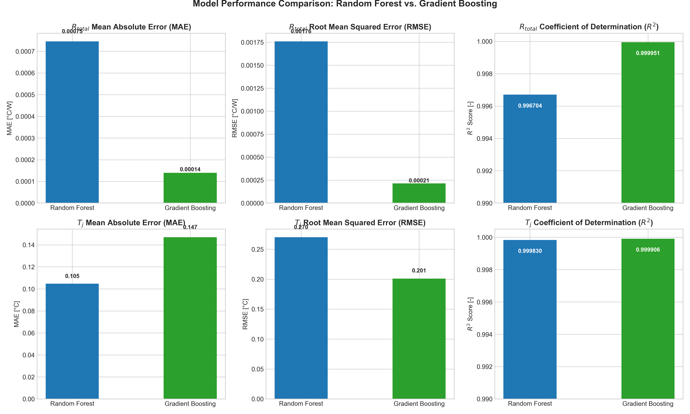
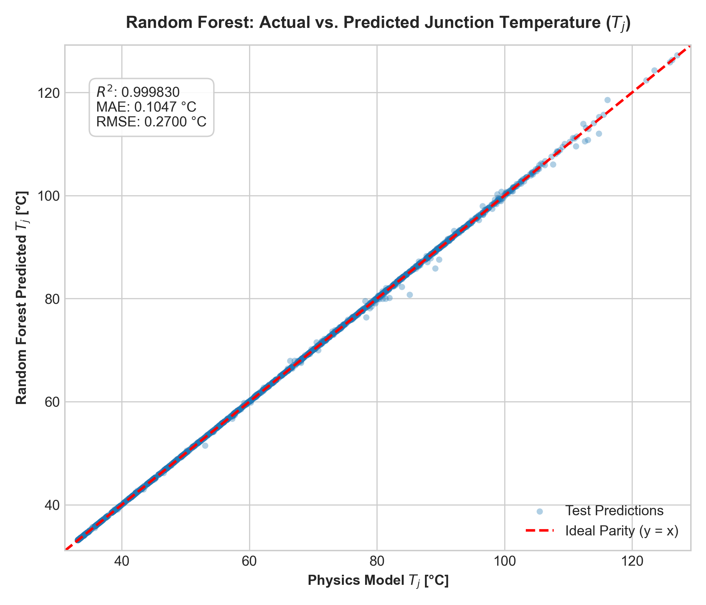
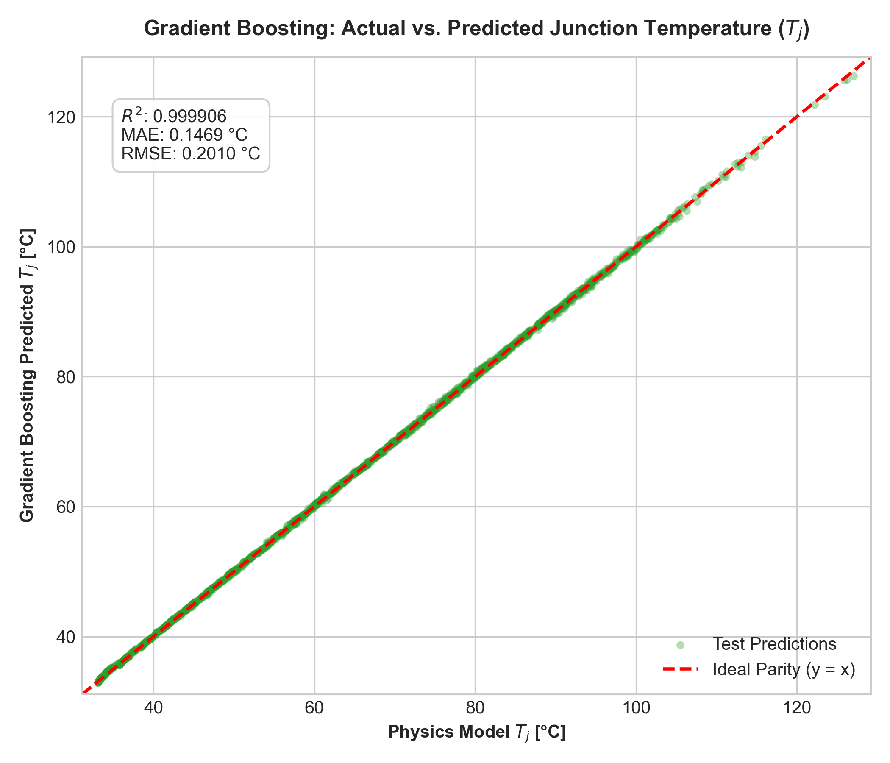
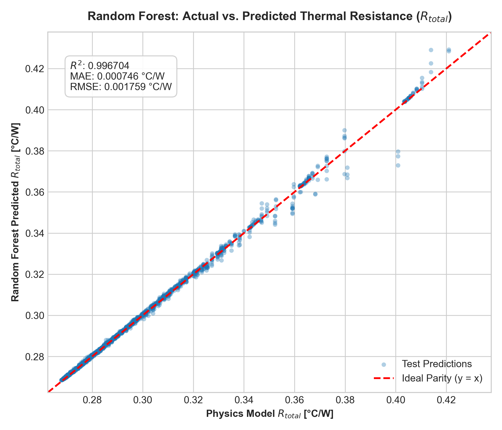
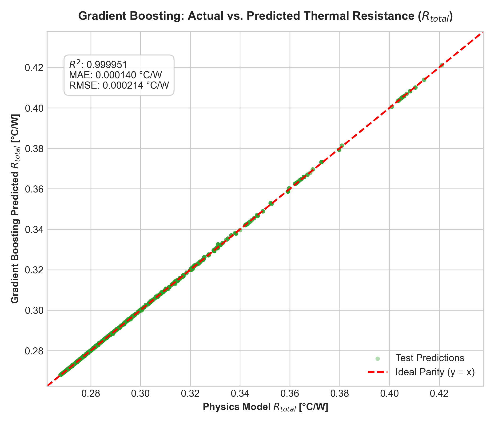
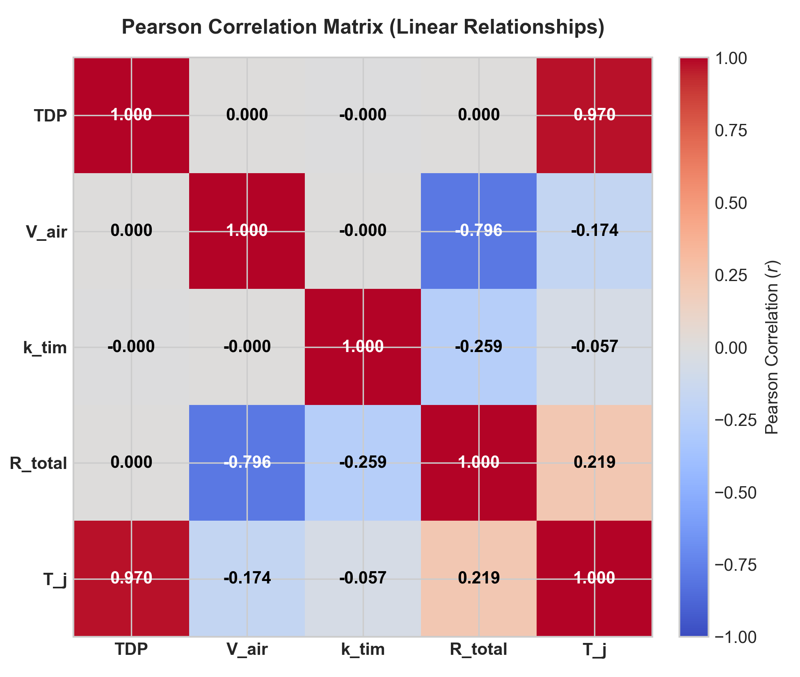
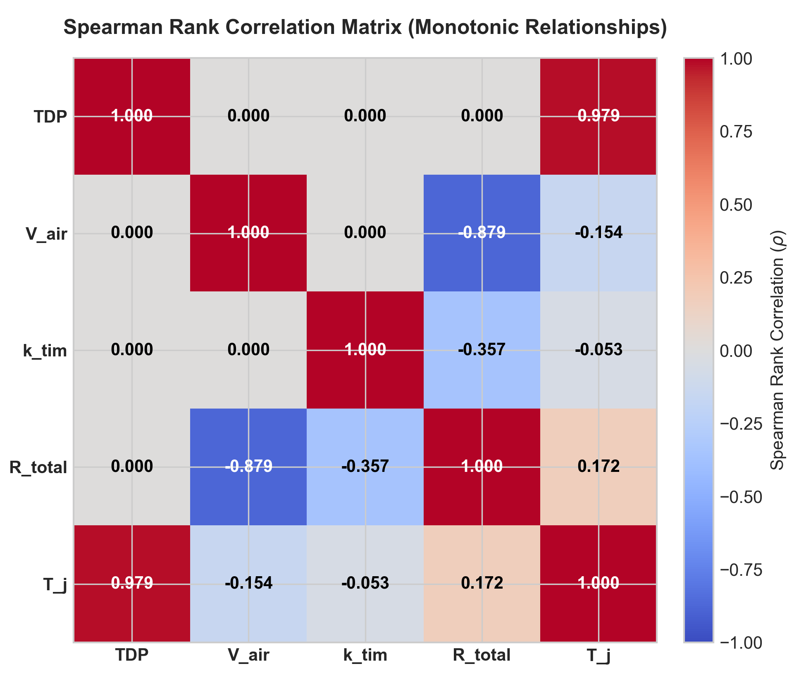
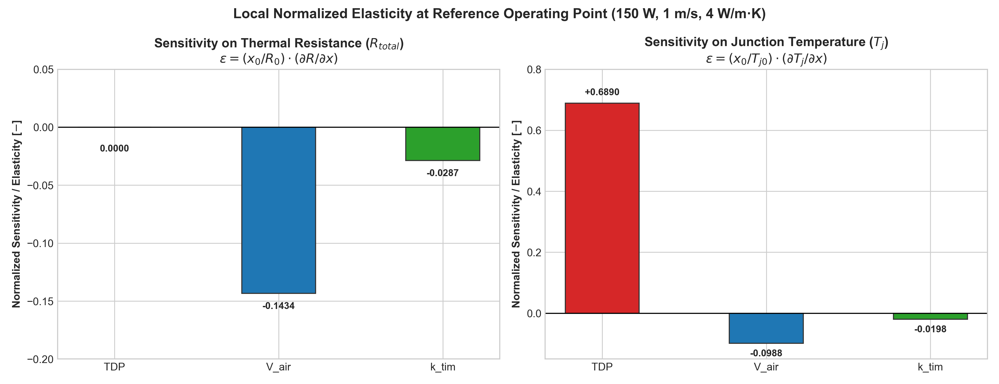

# Heat Sink Thermal Performance Prediction Using Machine Learning

## 1. Project Overview

This project presents an engineering and machine learning workflow to evaluate and accelerate heat-sink thermal performance analysis. An analytical, physics-based thermal resistance model is implemented in Python to estimate the total thermal resistance ($R_{total}$) and processor junction temperature ($T_j$) of an air-cooled plate-fin heat sink.

Thermal performance prediction is a critical stage in electronic packaging and microprocessor system design. Inadequate heat dissipation causes elevated junction temperatures, accelerating silicon aging, inducing thermal throttling, and potentially leading to permanent hardware failure. 

To enable rapid design space exploration, a full-factorial parameter sweep generates a high-fidelity synthetic dataset across key operating variables. Two supervised machine learning surrogate models—**Random Forest Regressor** and **Gradient Boosting Regressor**—are trained on this dataset. These surrogate models approximate the physics-based calculations with sub-millisecond inference speed, allowing thermal engineers to rapidly evaluate thousands of design variations during early architecture and trade-off studies.

The ML surrogate models approximate the implemented semi-empirical physics equations and are not intended to replace high-fidelity 3D Computational Fluid Dynamics (CFD) or Finite Element Analysis (FEA) simulations.

---

## 2. Problem Statement

Thermal engineers must accurately estimate heat-sink thermal resistance ($R_{total}$) and processor junction temperature ($T_j$) across diverse operational conditions. These output metrics depend directly on three key operational inputs:
- Processor heat dissipation power (**TDP**)
- Forced-air approach velocity (**Air Velocity**)
- Thermal Interface Material thermal conductivity (**TIM Conductivity**)

Traditional engineering workflows require re-evaluating coupled convective and conductive thermal equations for every operating point. While computationally lightweight for single calculations, repeated evaluations across wide operational envelopes, optimization loops, and real-time system monitors can become cumbersome.

This project investigates whether machine learning surrogate models can accurately learn and reproduce the underlying relationships of the implemented physics model, delivering instant predictions while maintaining strict consistency with thermodynamic and fluid mechanics principles.

---

## 3. Project Objectives

- **Develop a Modular Physics Model:** Refactor legacy script calculations into a reusable, parameter-driven Python function (`calculate_heat_sink`).
- **Conduct Parameter Sweeps:** Perform a full-factorial parameter grid sweep across operational ranges of TDP, air velocity, and TIM conductivity.
- **Generate and Validate Dataset:** Construct a structured 34-column CSV dataset with 8,280 design points and apply rigorous automated quality and physical sanity checks.
- **Train ML Surrogate Models:** Build multi-target Random Forest and Gradient Boosting regression pipelines to predict $R_{total}$ and $T_j$.
- **Evaluate Model Performance:** Quantify prediction fidelity on held-out test data using Mean Absolute Error (MAE), Root Mean Squared Error (RMSE), and Coefficient of Determination ($R^2$).
- **Perform Sensitivity and Correlation Analysis:** Determine linear (Pearson), monotonic (Spearman), local finite-difference, and test-set permutation feature importances.
- **Document Engineering Insights:** Package all code, datasets, serialized models, tabular results, publication-quality plots, and formal reports into a reproducible repository.

---

## 4. Technology Stack

The project relies exclusively on standard Python scientific computing and machine learning libraries:

- **Python** (Core programming language)
- **NumPy** (Numerical computing, vector math, and grid generation)
- **Pandas** (Tabular data manipulation, validation, and CSV export)
- **Scikit-learn** (Surrogate modeling: `RandomForestRegressor`, `GradientBoostingRegressor`, `MultiOutputRegressor`, evaluation metrics, and permutation importance)
- **Matplotlib** (Engineering visualizations, parity plots, correlation heatmaps, and metric bars)
- **Joblib** (Efficient model serialization and persistence)

*(Note: SciPy was evaluated but not required; all calculations are implemented natively using NumPy and Scikit-learn.)*

---

## 5. System Workflow

The end-to-end execution pipeline follows an engineering-driven workflow:

```text
Original heat-sink calculation (Heat_Sink_calculation.py)
    │
    ▼
Parameterized physics model (heat_sink_model.py)
    │
    ▼
Automated model verification (validate_model.py)
    │
    ▼
Parameter sweep & validation (generate_dataset.py)
    │
    ▼
CSV dataset generation (02_Dataset/thermal_dataset.csv)
    │
    ▼
ML model training & evaluation (train_models.py)
    │
    ▼
Correlation & sensitivity analysis (sensitivity_analysis.py)
    │
    ▼
Final results, plots & technical reports (04_Results, 05_Written_Responses, 06_Summary_Report)
```

---

## 6. Input Parameters and Outputs

### Variable Input Parameters

The parameter sweep varies three operational parameters over practical engineering ranges:

| Parameter | Symbol | Range | Step Size | Total Values | Units |
|---|---|---:|---:|---:|---|
| Processor Thermal Design Power | TDP | 30–250 W | 10 W | 23 | W |
| Approach Air Velocity | $V_{air}$ | 0.5–15 m/s | 0.5 m/s | 30 | m/s |
| TIM Thermal Conductivity | $k_{tim}$ | 1–12 W/(m·K) | 1 W/(m·K) | 12 | W/(m·K) |

### Prediction Targets

The machine learning models predict two continuous thermal targets simultaneously:

1. **Total Thermal Resistance ($R_{total}$)** [°C/W]: Overall thermal resistance from die junction to ambient cooling air:
   $$R_{total} = R_{jc} + R_{tim} + R_{conv}$$
2. **Processor Junction Temperature ($T_j$)** [°C]: Operating temperature of the semiconductor die:
   $$T_j = T_{ambient} + (TDP \times R_{total})$$

### Fixed Geometric and Environmental Baseline Constants

- Ambient Air Temperature ($T_{ambient}$): $25.0 \text{ ^\circ C}$
- Die Dimensions ($L_{die} \times W_{die}$): $52.5 \text{ mm} \times 45.0 \text{ mm}$ ($A_{die} = 0.0023625 \text{ m}^2$)
- Junction-to-Case Resistance ($R_{jc}$): $0.20 \text{ ^\circ C/W}$
- TIM Thickness ($t_{tim}$): $0.10 \text{ mm}$
- Heat Sink Dimensions ($L \times W \times H$): $90 \text{ mm} \times 116 \text{ mm} \times 27 \text{ mm}$
- Fin Array: $N_{fins} = 60$, Fin Thickness $t_f = 0.8 \text{ mm}$, Base Thickness $t_b = 2.5 \text{ mm}$
- Air Properties at 25°C: $k_{air} = 0.0262 \text{ W/(m}\cdot\text{K)}$, $\nu_{air} = 1.57 \times 10^{-5} \text{ m}^2/\text{s}$, $Pr_{air} = 0.71$

---

## 7. Dataset

The complete generated dataset is stored in [`02_Dataset/thermal_dataset.csv`](02_Dataset/thermal_dataset.csv).

- **Total Samples:** $23 \times 30 \times 12 = 8,280$ unique operating combinations.
- **Columns (34 total):** Includes operational inputs, intermediate fluid properties, fin geometric parameters, convective coefficients, area breakdowns, resistance components ($R_{conv}$, $R_{tim}$, $R_{hs}$, $R_{total}$), and junction temperature ($T_j$).
- **Data Integrity & Quality Assurance:**
  - Zero missing (null) values.
  - Zero infinite values across all numerical columns.
  - Zero duplicate parameter combinations.
  - All calculated Reynolds numbers satisfy laminar flow conditions ($36.7 \le Re \le 1101.2 < 2300$).
  - Physical validity guaranteed: $R_{total} > 0$ and $T_j > T_{ambient}$ for all rows.
  - Reference condition check (TDP = 150 W, $V_{air} = 1.0 \text{ m/s}$, $k_{tim} = 4.0 \text{ W/(m}\cdot\text{K)}$) matches baseline script outputs exactly ($R_{total} = 0.369205 \text{ ^\circ C/W}$, $T_j = 80.3807 \text{ ^\circ C}$).

---

## 8. Machine Learning Models

Two multi-target regression models were trained on an 80/20 train-test split (6,624 train samples, 1,656 test samples, `random_state=42`):

- **Random Forest Regressor:** An ensemble learning method using 200 bootstrap decision trees (`n_estimators=200`, `random_state=42`, `n_jobs=-1`). Individual trees capture non-linear feature splits, and predictions are averaged to minimize prediction variance.
- **Gradient Boosting Regressor:** A sequential boosting ensemble wrapped in `MultiOutputRegressor` (`n_estimators=200`, `learning_rate=0.05`, `max_depth=3`, `random_state=42`). Trees iteratively fit negative gradients of the squared-error loss function with shrinkage.

### Verified Test-Set Evaluation Metrics

Evaluation metrics computed on the 1,656 held-out test samples:

| Model | Target | MAE | RMSE | $R^2$ Score |
|---|---|---:|---:|---:|
| **Random Forest** | Total Thermal Resistance ($R_{total}$) | **0.000746 °C/W** | **0.001759 °C/W** | **0.996704** |
| **Random Forest** | Junction Temperature ($T_j$) | **0.104693 °C** | **0.269990 °C** | **0.999830** |
| **Gradient Boosting** | Total Thermal Resistance ($R_{total}$) | **0.000140 °C/W** | **0.000214 °C/W** | **0.999951** |
| **Gradient Boosting** | Junction Temperature ($T_j$) | **0.146933 °C** | **0.200998 °C** | **0.999906** |

> [!IMPORTANT]
> These metrics quantify how closely the ML models replicate the synthetic data generated by the implemented analytical physics equations. They represent surrogate approximation fidelity, not experimental accuracy against physical hardware measurements.

Serialized models and configuration metadata are located in [`03_ML_Models/`](03_ML_Models/), and tabular metrics are stored in [`04_Results/model_comparison.csv`](04_Results/model_comparison.csv).

---

## 9. Correlation and Sensitivity Analysis

To investigate parameter interactions and establish thermal design rules, four complementary analyses were performed:

1. **Pearson Correlation Coefficient ($r$):** Quantifies linear relationships between inputs and outputs.
2. **Spearman Rank Correlation ($\rho$):** Quantifies monotonic relationships without assuming linearity.
3. **Local Finite-Difference Sensitivity:** Computes localized derivatives ($\frac{\partial y}{\partial x}$) and non-dimensional elasticities ($\frac{\% \Delta y}{\% \Delta x}$) around the nominal reference design point.
4. **Permutation Feature Importance:** Measures surrogate model degradation (drop in test $R^2$) when feature values are randomly shuffled.

### Key Engineering Findings

- **Air Velocity vs. Thermal Resistance:** Air velocity exhibits a strong negative correlation with total thermal resistance ($r = -0.7964$, $\rho = -0.8788$). In the laminar flow regime, convective heat transfer scales as $h \propto V_{air}^{1/3}$, resulting in steep resistance reductions between 0.5 and 3.0 m/s, with diminishing returns beyond 6.0 m/s.
- **TDP vs. Junction Temperature:** TDP is strictly positively correlated with junction temperature ($r = 0.9702$, $\rho = 0.9788$). Because $T_j = T_{ambient} + (TDP \times R_{total})$, junction temperature scales linearly with power at any fixed airflow and TIM condition.
- **TIM Conductivity Impact:** TIM conductivity reduces interface resistance ($R_{tim} = \frac{t_{tim}}{k_{tim} A_{die}}$) following a hyperbolic $\frac{1}{k_{tim}}$ relationship. Increasing $k_{tim}$ from 1 to 4 W/(m·K) yields substantial thermal gains, while increases beyond 6–8 W/(m·K) exhibit asymptotic saturation.
- **TDP Independence of Thermal Resistance:** TDP has an exact correlation of $0.0000$ with $R_{total}$. In the implemented linear thermal circuit, material properties and convective coefficients are assumed temperature-independent; hence, thermal resistance is purely a function of geometry, velocity, and conductivity.

Result tables are stored in [`04_Results/`](04_Results/) and corresponding visualizations in [`04_Results/plots/`](04_Results/plots/).

---

## 10. Project Structure

The project follows a clean, modular repository layout:

```text
Expert_Thermal_project/
│
├── 01_Python_Code/
│   ├── Heat_Sink_calculation.py      # Original reference calculation script
│   ├── heat_sink_model.py            # Modular, parameterized heat-sink physics function
│   ├── validate_model.py             # Automated unit tests and reference verification
│   ├── generate_dataset.py           # Full factorial parameter sweep and CSV generator
│   ├── train_models.py               # ML model training, evaluation, and serialization
│   └── sensitivity_analysis.py       # Correlation, sensitivity, and permutation analysis
│
├── 02_Dataset/
│   └── thermal_dataset.csv           # Generated 8,280-row parametric dataset (34 columns)
│
├── 03_ML_Models/
│   ├── random_forest_model.joblib    # Trained Random Forest multi-target model (36.5 MB)
│   ├── gradient_boosting_model.joblib# Trained Gradient Boosting multi-target model (153 KB)
│   └── model_metadata.json           # Model hyperparameter and training metadata
│
├── 04_Results/
│   ├── model_comparison.csv          # MAE, RMSE, and R² summary table
│   ├── correlation_pearson.csv       # Pearson correlation matrix
│   ├── correlation_spearman.csv      # Spearman rank correlation matrix
│   ├── sensitivity_local_derivatives.csv # Local sensitivity derivatives and elasticities
│   ├── sensitivity_full_span.csv     # Full-range dynamic span analysis
│   ├── permutation_importance.csv    # Test set permutation feature importance
│   └── plots/                        # High-resolution engineering charts and figures
│
├── 05_Written_Responses/
│   └── Written_Responses.pdf         # Completed technical responses document
│
├── 06_Summary_Report/
│   └── Expert_Thermal_Summary_Report.pdf # Formal engineering summary report
│
├── README.md                         # Comprehensive project documentation
├── requirements.txt                  # Python dependencies
└── .gitignore                        # Git ignore rules for virtual environments and caches
```

> [!NOTE]
> The written responses deliverable is preserved in its authentic, completed PDF format as [`05_Written_Responses/Written_Responses.pdf`](05_Written_Responses/Written_Responses.pdf). In accordance with documentation integrity standards, no placeholder `.docx` file was created.

---

## 11. Installation and Execution

### Prerequisites

- Windows 10/11 (or Linux/macOS)
- Python 3.9, 3.10, 3.11, or 3.12 installed and added to `PATH`
- Git installed

### Environment Setup

Open PowerShell or Command Prompt and clone the repository:

```bash
git clone https://github.com/kjeevankumar/Expert_Thermal_project.git
cd Expert_Thermal_project

python -m venv venv
venv\Scripts\activate

pip install -r requirements.txt
```

*(On Linux or macOS, activate the virtual environment with `source venv/bin/activate`.)*

### Execution Order

Run the scripts in sequential order from the project root:

```bash
python 01_Python_Code/Heat_Sink_calculation.py
python 01_Python_Code/heat_sink_model.py
python 01_Python_Code/validate_model.py
python 01_Python_Code/generate_dataset.py
python 01_Python_Code/train_models.py
python 01_Python_Code/sensitivity_analysis.py
```

### Script Execution Summary

1. `Heat_Sink_calculation.py`: Runs the original baseline heat-sink script to compute the baseline reference operating condition ($TDP = 150 \text{ W}$, $V_{air} = 1.0 \text{ m/s}$, $k_{tim} = 4.0 \text{ W/(m}\cdot\text{K)}$).
2. `heat_sink_model.py`: Runs the parameterized modular physics model and executes an automated parity comparison against the baseline script.
3. `validate_model.py`: Runs the validation test suite verifying numerical tolerances, laminar/turbulent branch logic, and parameter variations.
4. `generate_dataset.py`: Executes the full factorial parameter grid sweep across 8,280 combinations, performs automated quality checks, and exports `02_Dataset/thermal_dataset.csv`.
5. `train_models.py`: Loads the dataset, performs 80/20 train/test split, trains Random Forest and Gradient Boosting regressors, evaluates metrics, persists models to `03_ML_Models/`, and exports evaluation plots to `04_Results/plots/`.
6. `sensitivity_analysis.py`: Computes Pearson/Spearman correlation matrices, finite-difference sensitivities, and permutation feature importances, exporting CSV tables and visualization plots to `04_Results/`.

---

## 12. Results and Visualizations

The generated evaluation plots and engineering figures are saved in [`04_Results/plots/`](04_Results/plots/).

### Model Comparison Metrics
Comparison of MAE, RMSE, and $R^2$ metrics across models and prediction targets:



### Actual vs. Predicted Parity Plots (Test Set)
Parity plots comparing surrogate model predictions against analytical physics calculations on the held-out test set:

| Random Forest | Gradient Boosting |
|:---:|:---:|
|  |  |
|  |  |

### Correlation Heatmaps
Statistical dependency matrices illustrating relationships among inputs and outputs:

| Pearson Linear Correlation | Spearman Rank Correlation |
|:---:|:---:|
|  |  |

### Parameter Sensitivity Comparison
One-at-a-time parameter sweeps highlighting dynamic response across the full operating range:



---

## 13. Limitations

- **Simplified 1D Thermal Resistance Network:** The analytical model assumes 1D one-directional conductive and convective heat paths, omitting three-dimensional heat spreading in the heat sink base.
- **Airflow Bypass Omission:** The equations assume duct-enclosed forced convection where 100% of the approach air passes through the fin channels; open-chassis airflow bypass and leakage around the heat sink are not modeled.
- **Radiation Heat Transfer Excluded:** Thermal radiation between fins and the surrounding environment is neglected, which can contribute 5–10% of total heat dissipation at low air velocities.
- **Laminar Flow Regime Scope:** Across all 8,280 parameter combinations, fin-spacing Reynolds numbers range from 36.7 to 1101.2 ($Re < 2300$). As a result, the dataset exclusively exercises the laminar heat transfer correlation branch.
- **Synthetic Data Training:** The machine learning surrogate models were trained and evaluated exclusively on synthetic data generated from the physics equations, meaning they reproduce the assumptions and limitations of the analytical model.
- **Physical Validation Required:** The models have not yet been calibrated against experimental wind-tunnel measurements or thermal test vehicle (TTV) hardware data.

---

## 14. Future Improvements

Future technical enhancements could extend this work:

- **CFD & FEA Cross-Validation:** Train and validate surrogate models against 3D computational fluid dynamics simulations (e.g., Ansys Icepak, FloTHERM, or OpenFOAM) to capture non-uniform flow fields and recirculation zones.
- **Experimental Hardware Calibration:** Calibrate thermal resistances using physical wind-tunnel test data across varying ambient conditions and heat source layouts.
- **Physics-Informed Machine Learning (PIML):** Implement Physics-Informed Neural Networks (PINNs) or embed hard conservation-of-energy constraints directly into the loss function to enforce thermodynamic laws across out-of-distribution inputs.
- **Interactive Engineering Interface:** Develop an interactive web application (e.g., Streamlit or Dash) allowing engineers to dynamically adjust heat sink dimensions, fan curves, and TIM parameters in real time.

---

## 15. Deliverables

All deliverables required for technical review and submission are organized within the repository:

- **Python Scripts:** [`01_Python_Code/`](01_Python_Code/)
- **Parametric Dataset:** [`02_Dataset/thermal_dataset.csv`](02_Dataset/thermal_dataset.csv)
- **Trained Machine Learning Models & Metadata:** [`03_ML_Models/`](03_ML_Models/)
- **Tabular Results & Engineering Plots:** [`04_Results/`](04_Results/)
- **Written Responses Document:** [`05_Written_Responses/Written_Responses.pdf`](05_Written_Responses/Written_Responses.pdf)
- **Summary Technical Report:** [`06_Summary_Report/Expert_Thermal_Summary_Report.pdf`](06_Summary_Report/Expert_Thermal_Summary_Report.pdf)
- **Python Dependencies:** [`requirements.txt`](requirements.txt)
- **Project Documentation:** [`README.md`](README.md)
